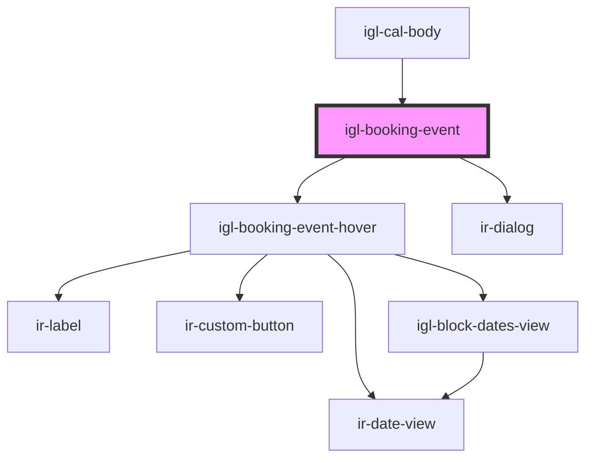

# igl-booking-event

<!-- Auto Generated Below -->

## Properties

| Property              | Attribute            | Description                                                                                                                                                                                                               | Type                              | Default     |
| --------------------- | -------------------- | ------------------------------------------------------------------------------------------------------------------------------------------------------------------------------------------------------------------------- | --------------------------------- | ----------- |
| `bookingEvent`        | --                   |                                                                                                                                                                                                                           | `{ [key: string]: any; }`         | `undefined` |
| `countries`           | --                   |                                                                                                                                                                                                                           | `ICountry[]`                      | `undefined` |
| `currency`            | `currency`           |                                                                                                                                                                                                                           | `any`                             | `undefined` |
| `getAllBookingEvents` | --                   | Every booking on the calendar, read only when a drop has to be checked for overlaps. A getter rather than the array itself, so that updating one booking does not hand every bar a new prop value and re-render them all. | `() => { [key: string]: any; }[]` | `undefined` |
| `is_vacation_rental`  | `is_vacation_rental` |                                                                                                                                                                                                                           | `boolean`                         | `false`     |
| `language`            | `language`           |                                                                                                                                                                                                                           | `string`                          | `undefined` |
| `roomTop`             | `room-top`           |                                                                                                                                                                                                                           | `number`                          | `undefined` |

## Events

| Event                  | Description | Type                                                                                                                                                                                                                                                                                                                                                                                                                     |
| ---------------------- | ----------- | ------------------------------------------------------------------------------------------------------------------------------------------------------------------------------------------------------------------------------------------------------------------------------------------------------------------------------------------------------------------------------------------------------------------------ |
| `dragOverEventData`    |             | `CustomEvent<any>`                                                                                                                                                                                                                                                                                                                                                                                                       |
| `showDialog`           |             | `CustomEvent<{ reason: "checkin"; bookingNumber: string; roomIdentifier: string; roomUnit: string; roomName: string; sidebarPayload: RoomGuestsPayload & { bookingNumber: string; }; } \| { reason: "checkout"; bookingNumber: string; roomIdentifier: string; roomUnit: string; roomName: string; booking: Booking; } \| { reason: "reallocate"; } & IReallocationPayload \| { reason: "stretch"; } & IRoomNightsData>` |
| `showRoomNightsDialog` |             | `CustomEvent<IRoomNightsData>`                                                                                                                                                                                                                                                                                                                                                                                           |
| `updateBookingEvent`   |             | `CustomEvent<{ [key: string]: any; }>`                                                                                                                                                                                                                                                                                                                                                                                   |

## Dependencies

### Used by

 - [igl-cal-body](../igl-cal-body)

### Depends on

- [igl-booking-event-hover](../igl-booking-event-hover)
- [ir-dialog](../../ui/ir-dialog)

### Graph

----------------------------------------------

*Built with [StencilJS](https://stenciljs.com/)*
