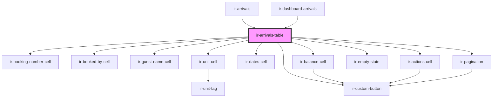

# ir-arrivals-table

<!-- Auto Generated Below -->

## Properties

| Property         | Attribute         | Description                                                                                                                                                                           | Type      | Default |
| ---------------- | ----------------- | ------------------------------------------------------------------------------------------------------------------------------------------------------------------------------------- | --------- | ------- |
| `hidePagination` | `hide-pagination` | Hides the pagination footer, for hosts that load the whole day in one page (the dashboard).                                                                                           | `boolean` | `false` |
| `pmsDisabled`    | `pms-disabled`    | For properties without front desk (PMS): check-in status isn't tracked, so every room arriving on the store's day is listed in one list, without overdue marks or the actions column. | `boolean` | `false` |

## Events

| Event                   | Description | Type                                                                                                                                                                                |
| ----------------------- | ----------- | ----------------------------------------------------------------------------------------------------------------------------------------------------------------------------------- |
| `checkInRoom`           |             | `CustomEvent<{ roomName: string; roomType?: string; sharing_persons: SharedPerson[]; totalGuests: number; checkin: boolean; identifier: string; booking_nbr?: string \| number; }>` |
| `requestPageChange`     |             | `CustomEvent<PaginationChangeEvent>`                                                                                                                                                |
| `requestPageSizeChange` |             | `CustomEvent<PaginationChangeEvent>`                                                                                                                                                |

## Dependencies

### Used by

 - [ir-arrivals](..)
 - [ir-dashboard-arrivals](../../ir-dashboard/ir-dashboard-arrivals)

### Depends on

- [ir-booking-number-cell](../../table-cells/booking/ir-booking-number-cell)
- [ir-booked-by-cell](../../table-cells/booking/ir-booked-by-cell)
- [ir-guest-name-cell](../../table-cells/booking/ir-guest-name-cell)
- [ir-unit-cell](../../table-cells/booking/ir-unit-cell)
- [ir-dates-cell](../../table-cells/booking/ir-dates-cell)
- [ir-balance-cell](../../table-cells/booking/ir-balance-cell)
- [ir-actions-cell](../../table-cells/booking/ir-actions-cell)
- [ir-empty-state](../../ir-empty-state)
- [ir-custom-button](../../ui/ir-custom-button)
- [ir-pagination](../../ir-pagination)

### Graph

----------------------------------------------

*Built with [StencilJS](https://stenciljs.com/)*
