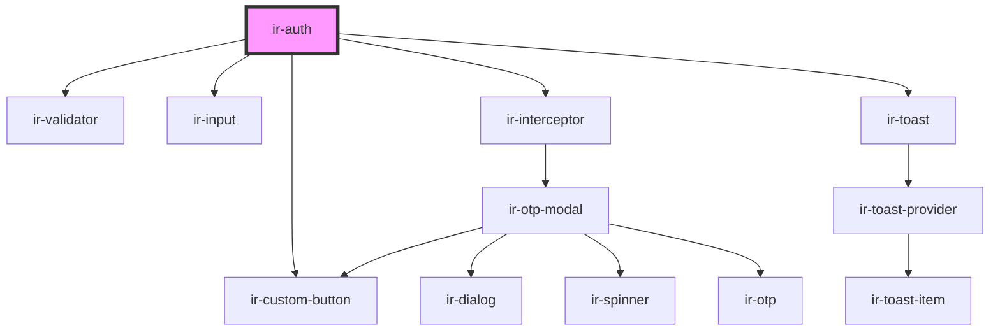

# ir-auth

<!-- Auto Generated Below -->

## Overview

The extranet sign-in panel: login, forgot password and forgot username.

Owns validation and the whole legacy login chain (`IsAuthenticated_JSON` →
`Get_Startup_Data_Signature` → `Get_Startup_Data`), then redirects the way
`Default.aspx` always has: to the OTP page, or by clicking the server's
`btn_RedirectFromLogin`, whose handler reads `Request.Form["txt_username"]`.

Renders no `<form>` of its own, and no encapsulation: mount it inside the page's
`<form runat="server">`, exactly where the legacy fields sat, so `#txt_username`
posts with the redirect like the original input did. Every other submit of that
form is intercepted and handled here.

## Properties

| Property         | Attribute         | Description                                                                                                                                                                     | Type                       | Default                   |
| ---------------- | ----------------- | ------------------------------------------------------------------------------------------------------------------------------------------------------------------------------- | -------------------------- | ------------------------- |
| `apiUrl`         | `api-url`         | Base URL of the app's WCF service the login endpoints live on — `_apiUri` in `js/CommonLibrary.js`. The default resolves next to the page (`…/Default.aspx` → `…/AppWCF.svc/`). | `string`                   | `'AppWCF.svc/'`           |
| `autoPassword`   | `auto-password`   |                                                                                                                                                                                 | `string`                   | `undefined`               |
| `autoUsername`   | `auto-username`   | When set together with {@link autoPassword}, signs in on load.                                                                                                                  | `string`                   | `undefined`               |
| `insideMpo`      | `inside-mpo`      | Hides the app links and the sign-up button when the page runs inside MPO.                                                                                                       | `boolean`                  | `false`                   |
| `language`       | `language`        | The page's current language, e.g. `<%= CurrentLanguage %>`.                                                                                                                     | `string`                   | `'en'`                    |
| `languages`      | `languages`       | Languages offered by the switcher, as an array or a JSON string of `{ code, label }`.                                                                                           | `AuthLanguage[] \| string` | `[]`                      |
| `logoUrl`        | `logo-url`        |                                                                                                                                                                                 | `string`                   | `undefined`               |
| `otpUrl`         | `otp-url`         | Where users who must confirm a one-time password are sent instead.                                                                                                              | `string`                   | `'./OTPVerifier.aspx'`    |
| `redirectButton` | `redirect-button` | Id of the server button whose postback signs the user in (`FormsAuthentication.RedirectFromLoginPage`).                                                                         | `string`                   | `'btn_RedirectFromLogin'` |

## Events

| Event                | Description                                                                                                | Type                                                               |
| -------------------- | ---------------------------------------------------------------------------------------------------------- | ------------------------------------------------------------------ |
| `authFinish`         | Fires after a successful login, before redirecting. Call `preventDefault()` to handle navigation yourself. | `CustomEvent<{ userInfo: LegacyUserInfo; requiresOtp: boolean; }>` |
| `authLanguageChange` |                                                                                                            | `CustomEvent<{ code: string; }>`                                   |

## Dependencies

### Depends on

- [ir-custom-button](../ui/ir-custom-button)
- [ir-validator](../ui/ir-validator)
- [ir-input](../ui/ir-input)
- [ir-interceptor](../ir-interceptor)
- [ir-toast](../ui/ir-toast)

### Graph

----------------------------------------------

*Built with [StencilJS](https://stenciljs.com/)*
