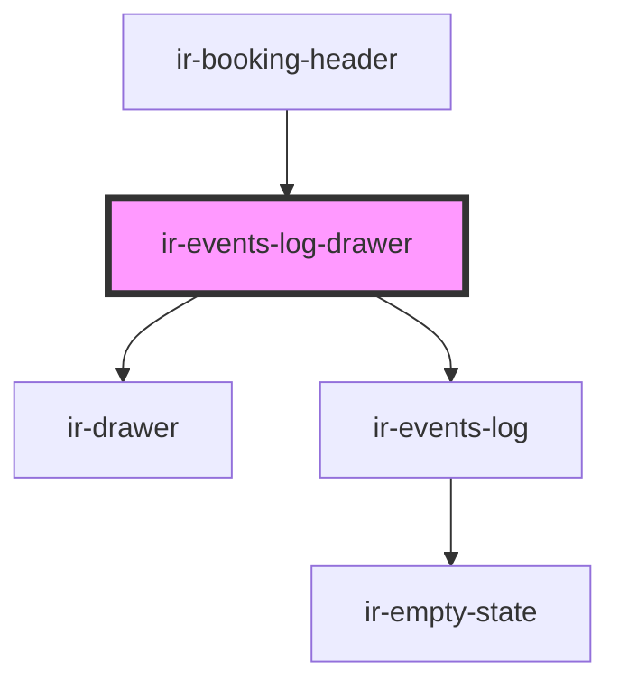

# ir-events-log-drawer

<!-- Auto Generated Below -->

## Overview

Side drawer showing a booking's events log (who did what, and when).

## Properties

| Property | Attribute | Description                                     | Type                    | Default     |
| -------- | --------- | ----------------------------------------------- | ----------------------- | ----------- |
| `events` | --        | Booking events, rendered in the order received. | `ExposedBookingEvent[]` | `[]`        |
| `open`   | `open`    | Controls whether the drawer is open.            | `boolean`               | `undefined` |

## Events

| Event                   | Description                                                                   | Type                                |
| ----------------------- | ----------------------------------------------------------------------------- | ----------------------------------- |
| `eventsLogDrawerClosed` | Emitted when the drawer is dismissed (close button, Escape or light dismiss). | `CustomEvent<{ source: Element; }>` |

## Dependencies

### Used by

 - [ir-booking-header](../..)

### Depends on

- [ir-drawer](../../../../ir-drawer)
- [ir-events-log](..)

### Graph

----------------------------------------------

*Built with [StencilJS](https://stenciljs.com/)*
