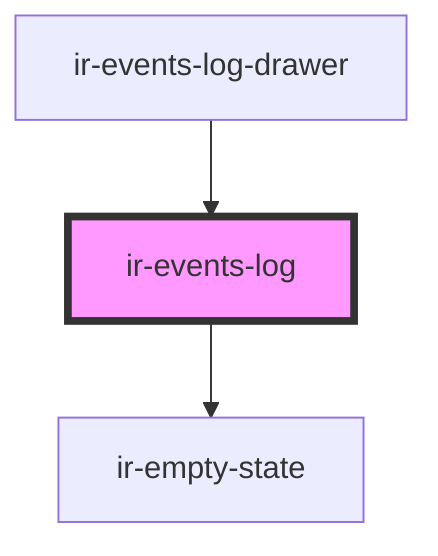

# ir-events-log

<!-- Auto Generated Below -->

## Properties

| Property | Attribute | Description                                     | Type                    | Default |
| -------- | --------- | ----------------------------------------------- | ----------------------- | ------- |
| `events` | --        | Booking events, rendered in the order received. | `ExposedBookingEvent[]` | `[]`    |

## Dependencies

### Used by

 - [ir-events-log-drawer](ir-events-log-drawer)

### Depends on

- [ir-empty-state](../../../ir-empty-state)

### Graph

----------------------------------------------

*Built with [StencilJS](https://stenciljs.com/)*
