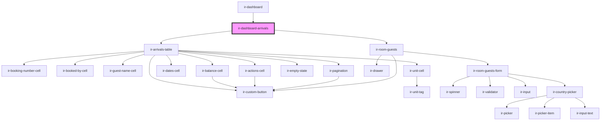

# ir-dashboard-arrivals

<!-- Auto Generated Below -->

## Overview

Arrivals panel of the dashboard: the existing arrivals table plus its check-in dialog.
Data lives in the arrivals store, loaded by the dashboard root as a single page, so there's no pagination.

## Properties

| Property      | Attribute      | Description                                                                        | Type         | Default     |
| ------------- | -------------- | ---------------------------------------------------------------------------------- | ------------ | ----------- |
| `countries`   | --             |                                                                                    | `ICountry[]` | `undefined` |
| `language`    | `language`     |                                                                                    | `string`     | `'en'`      |
| `pmsDisabled` | `pms-disabled` | Property without front desk: every arriving room in one list, no check-in actions. | `boolean`    | `false`     |

## Dependencies

### Used by

 - [ir-dashboard](..)

### Depends on

- [ir-arrivals-table](../../ir-arrivals/ir-arrivals-table)
- [ir-room-guests](../../ir-booking-details/ir-room-guests)

### Graph

----------------------------------------------

*Built with [StencilJS](https://stenciljs.com/)*
