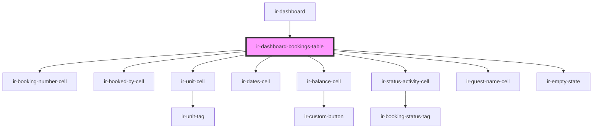

# ir-dashboard-bookings-table

<!-- Auto Generated Below -->

## Overview

Read-only booking list used by the dashboard's In-house, Bookings and Cancellations panels, built from the shared
booking table cells. In-house lists one row per occupied room; Bookings and Cancellations list one row per booking,
with its rooms' units stacked in the Unit cell.

## Properties

| Property       | Attribute       | Description                                                                                                                      | Type                                            | Default     |
| -------------- | --------------- | -------------------------------------------------------------------------------------------------------------------------------- | ----------------------------------------------- | ----------- |
| `bookings`     | --              |                                                                                                                                  | `Booking[]`                                     | `[]`        |
| `date`         | `date`          | The dashboard's selected day: balance payments (e.g. a cancellation's charge or refund) are recorded on it rather than on today. | `string`                                        | `undefined` |
| `emptyMessage` | `empty-message` |                                                                                                                                  | `string`                                        | `undefined` |
| `variant`      | `variant`       | In-house drops the Balance and Status columns that Bookings and Cancellations end with.                                          | `"cancellations" \| "inHouse" \| "newBookings"` | `'inHouse'` |

## Dependencies

### Used by

 - [ir-dashboard](..)

### Depends on

- [ir-booking-number-cell](../../table-cells/booking/ir-booking-number-cell)
- [ir-booked-by-cell](../../table-cells/booking/ir-booked-by-cell)
- [ir-unit-cell](../../table-cells/booking/ir-unit-cell)
- [ir-dates-cell](../../table-cells/booking/ir-dates-cell)
- [ir-balance-cell](../../table-cells/booking/ir-balance-cell)
- [ir-status-activity-cell](../../table-cells/booking/ir-status-activity-cell)
- [ir-guest-name-cell](../../table-cells/booking/ir-guest-name-cell)
- [ir-empty-state](../../ir-empty-state)

### Graph

----------------------------------------------

*Built with [StencilJS](https://stenciljs.com/)*
