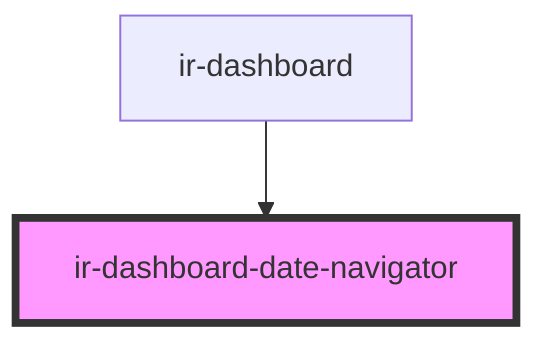

# ir-dashboard-date-navigator

<!-- Auto Generated Below -->

## Overview

Day picker for the dashboard header: a pill showing the selected day that opens a list of the days from
today to `MAX_DAY_OFFSET` after it. Past days aren't offered.

## Properties

| Property | Attribute | Description                  | Type     | Default     |
| -------- | --------- | ---------------------------- | -------- | ----------- |
| `date`   | `date`    | Selected day (`YYYY-MM-DD`). | `string` | `undefined` |

## Events

| Event        | Description                                               | Type                  |
| ------------ | --------------------------------------------------------- | --------------------- |
| `dateChange` | Emitted with the new day when the user picks another day. | `CustomEvent<string>` |

## Dependencies

### Used by

 - [ir-dashboard](..)

### Graph

----------------------------------------------

*Built with [StencilJS](https://stenciljs.com/)*
