# ir-dashboard-departures

<!-- Auto Generated Below -->

## Overview

Departures panel of the dashboard: the existing departures table plus its check-out and invoice dialogs.
Early check-outs are handed to the root, which opens them inside booking details.

## Properties

| Property      | Attribute      | Description                                                                          | Type      | Default     |
| ------------- | -------------- | ------------------------------------------------------------------------------------ | --------- | ----------- |
| `date`        | `date`         |                                                                                      | `string`  | `undefined` |
| `pmsDisabled` | `pms-disabled` | Property without front desk: every departing room in one list, no check-out actions. | `boolean` | `false`     |
| `propertyId`  | `property-id`  |                                                                                      | `number`  | `undefined` |

## Events

| Event              | Description                                                             | Type                                 |
| ------------------ | ----------------------------------------------------------------------- | ------------------------------------ |
| `checkoutRedirect` | Early check-out that must be completed from the booking-details drawer. | `CustomEvent<CheckoutRedirectEvent>` |

## Dependencies

### Used by

 - [ir-dashboard](..)

### Depends on

- [ir-departures-table](../../ir-departures/ir-departures-table)
- [ir-checkout-dialog](../../ir-checkout-dialog)
- [ir-invoice](../../ir-invoice)

### Graph

```mermaid
graph TD;
  ir-dashboard-departures --> ir-departures-table
  ir-dashboard-departures --> ir-checkout-dialog
  ir-dashboard-departures --> ir-invoice
  ir-departures-table --> ir-booking-number-cell
  ir-departures-table --> ir-booked-by-cell
  ir-departures-table --> ir-guest-name-cell
  ir-departures-table --> ir-unit-cell
  ir-departures-table --> ir-dates-cell
  ir-departures-table --> ir-balance-cell
  ir-departures-table --> ir-actions-cell
  ir-departures-table --> ir-empty-state
  ir-departures-table --> ir-custom-button
  ir-departures-table --> ir-pagination
  ir-unit-cell --> ir-unit-tag
  ir-balance-cell --> ir-custom-button
  ir-actions-cell --> ir-custom-button
  ir-pagination --> ir-custom-button
  ir-checkout-dialog --> ir-input
  ir-checkout-dialog --> ir-custom-button
  ir-checkout-dialog --> ir-dialog
  ir-checkout-dialog --> ir-spinner
  ir-checkout-dialog --> ir-payment-folio
  ir-payment-folio --> ir-drawer
  ir-payment-folio --> ir-payment-folio-form
  ir-payment-folio --> ir-custom-button
  ir-payment-folio-form --> ir-date-select
  ir-payment-folio-form --> ir-validator
  ir-payment-folio-form --> ir-input
  ir-date-select --> ir-input
  ir-date-select --> ir-air-date-picker
  ir-invoice --> ir-drawer
  ir-invoice --> ir-invoice-form
  ir-invoice --> ir-custom-button
  ir-invoice --> ir-fiscal-document-preview
  ir-invoice-form --> ir-spinner
  ir-invoice-form --> ir-date-select
  ir-invoice-form --> ir-booking-billing-recipient
  ir-invoice-form --> ir-empty-state
  ir-booking-billing-recipient --> ir-booking-company-dialog
  ir-booking-company-dialog --> ir-dialog
  ir-booking-company-dialog --> ir-booking-company-form
  ir-booking-company-dialog --> ir-custom-button
  ir-booking-company-form --> ir-input
  ir-fiscal-document-preview --> ir-cl-fiscal-document-preview
  ir-fiscal-document-preview --> ir-guest-document-preview
  ir-cl-fiscal-document-preview --> ir-spinner
  ir-cl-fiscal-document-preview --> ir-pdf-viewer
  ir-cl-fiscal-document-preview --> ir-preview-screen-dialog
  ir-cl-fiscal-document-preview --> ir-custom-button
  ir-cl-fiscal-document-preview --> ir-fd-confirm-dialog
  ir-preview-screen-dialog --> ir-dialog
  ir-preview-screen-dialog --> ir-custom-button
  ir-fd-confirm-dialog --> ir-dialog
  ir-fd-confirm-dialog --> ir-input
  ir-fd-confirm-dialog --> ir-custom-button
  ir-guest-document-preview --> ir-pdf-viewer
  ir-guest-document-preview --> ir-spinner
  ir-guest-document-preview --> ir-preview-screen-dialog
  ir-guest-document-preview --> ir-custom-button
  ir-dashboard --> ir-dashboard-departures
  style ir-dashboard-departures fill:#f9f,stroke:#333,stroke-width:4px
```

----------------------------------------------

*Built with [StencilJS](https://stenciljs.com/)*
