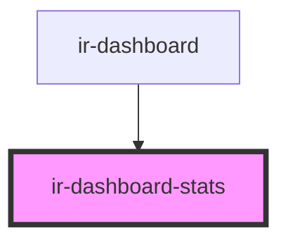

# ir-dashboard-stats

<!-- Auto Generated Below -->

## Overview

Left-hand stats rail: an occupancy card (the day's occupancy, units booked and the unit breakdown) followed by a
performance card with the day's room-revenue KPIs. The first card takes the rail's spare height.
The figures come from three requests (monthly stats, calendar, pending bookings), so each figure shows its own
skeleton until it arrives.

Properties without front desk (`isPms` false) see only Booked and Pending — no occupancy, no bar, no calendar
figures (the dashboard skips the calendar request for them) — and no RevPAR.

## Properties

| Property             | Attribute             | Description                                                                                           | Type                                              | Default     |
| -------------------- | --------------------- | ----------------------------------------------------------------------------------------------------- | ------------------------------------------------- | ----------- |
| `currencySymbol`     | `currency-symbol`     |                                                                                                       | `string`                                          | `undefined` |
| `date`               | `date`                | Selected day (`YYYY-MM-DD`); titles the occupancy card.                                               | `string`                                          | `undefined` |
| `density`            | `density`             | How tightly the cards are drawn; ir-dashboard steps it down when the desktop rail is short.           | `"compact" \| "regular" \| "spacious" \| "tight"` | `'regular'` |
| `isPms`              | `is-pms`              | Whether the property uses the front desk (PMS); without it the rail shows the reduced set of figures. | `boolean`                                         | `true`      |
| `pendingLoading`     | `pending-loading`     | Dims the pending-units figure while a newer day's is in flight.                                       | `boolean`                                         | `false`     |
| `pendingUnits`       | `pending-units`       | Units in pending bookings; `null` shows its skeleton.                                                 | `number`                                          | `undefined` |
| `performance`        | --                    | Occupancy and revenue figures; `null` shows their skeletons.                                          | `DashboardPerformance`                            | `undefined` |
| `performanceLoading` | `performance-loading` | Dims the occupancy, booked-units and revenue figures while a newer day's are in flight.               | `boolean`                                         | `false`     |
| `units`              | --                    | Calendar unit breakdown; `null` shows its skeleton.                                                   | `DashboardUnits`                                  | `undefined` |
| `unitsLoading`       | `units-loading`       | Dims the calendar unit figures while a newer day's are in flight.                                     | `boolean`                                         | `false`     |

## Dependencies

### Used by

 - [ir-dashboard](..)

### Graph

----------------------------------------------

*Built with [StencilJS](https://stenciljs.com/)*
