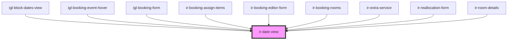

# ir-date-view

<!-- Auto Generated Below -->

## Properties

| Property             | Attribute              | Description                                            | Type                                                                              | Default     |
| -------------------- | ---------------------- | ------------------------------------------------------ | --------------------------------------------------------------------------------- | ----------- |
| `format`             | `format`               | Display style for both dates                           | `"day-only" \| "long" \| "medium" \| "month-year" \| "short" \| "weekday-medium"` | `'medium'`  |
| `from_date`          | `from_date`            | Raw from-date — accepts ISO string, JS Date, or Moment | `Date \| Moment \| string`                                                        | `undefined` |
| `showDateDifference` | `show-date-difference` | Show the night-count badge after the to-date           | `boolean`                                                                         | `true`      |
| `to_date`            | `to_date`              | Raw to-date — accepts ISO string, JS Date, or Moment   | `Date \| Moment \| string`                                                        | `undefined` |

## Shadow Parts

| Part               | Description |
| ------------------ | ----------- |
| `"base"`           |             |
| `"from-date"`      |             |
| `"night-count"`    |             |
| `"separator"`      |             |
| `"separator-icon"` |             |
| `"to-date"`        |             |

## Dependencies

### Used by

 - [igl-block-dates-view](../igloo-calendar/igl-block-dates-view)
 - [igl-booking-event-hover](../igloo-calendar/igl-booking-event-hover)
 - [igl-booking-form](../igloo-calendar/igl-book-property/igl-booking-form)
 - [ir-booking-assign-items](../ir-booking-details/ir-booking-source-editor-dialog/ir-booking-assign-items)
 - [ir-booking-editor-form](../igloo-calendar/ir-booking-editor/ir-booking-editor-form)
 - [ir-booking-rooms](../ir-booking-details/ir-booking-rooms)
 - [ir-extra-service](../ir-booking-details/ir-extra-services/ir-extra-service)
 - [ir-reallocation-form](../ir-reallocation-drawer/ir-reallocation-form)
 - [ir-room-details](../ir-booking-details/ir-room/ir-room-details)

### Graph

----------------------------------------------

*Built with [StencilJS](https://stenciljs.com/)*
