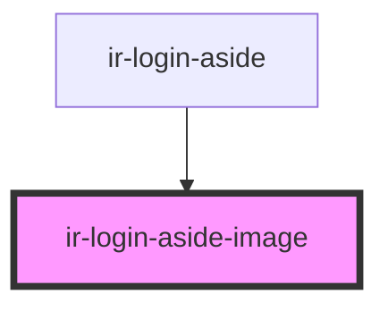

# ir-login-aside-image

<!-- Auto Generated Below -->

## Properties

| Property   | Attribute   | Description                                                        | Type     | Default     |
| ---------- | ----------- | ------------------------------------------------------------------ | -------- | ----------- |
| `imageAlt` | `image-alt` | Alternative text. Leave empty when the image is purely decorative. | `string` | `''`        |
| `imageSrc` | `image-src` | Image URL rendered as the aside background.                        | `string` | `undefined` |

## Dependencies

### Used by

 - [ir-login-aside](..)

### Graph

----------------------------------------------

*Built with [StencilJS](https://stenciljs.com/)*
