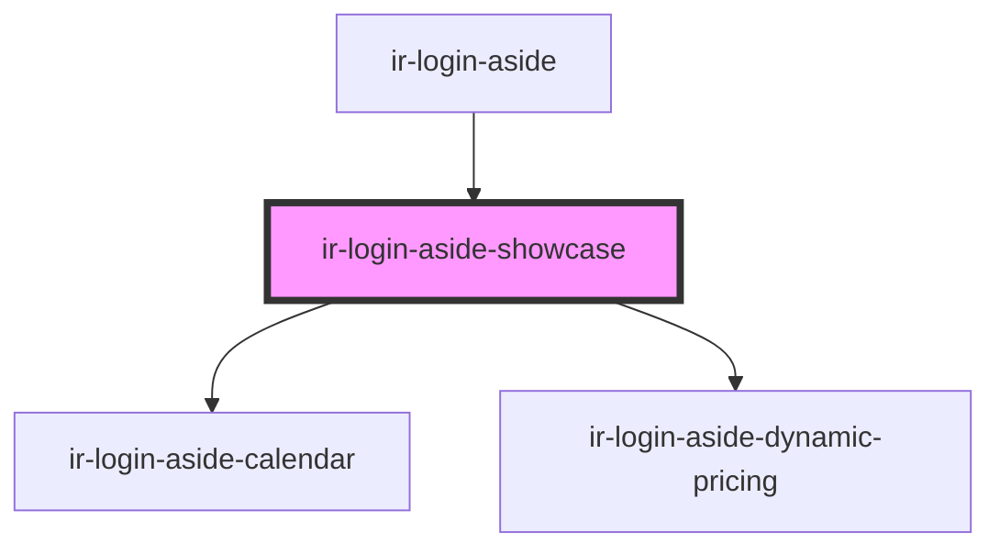

# ir-login-aside-showcase

<!-- Auto Generated Below -->

## Properties

| Property        | Attribute | Description                                                                                                   | Type                       | Default |
| --------------- | --------- | ------------------------------------------------------------------------------------------------------------- | -------------------------- | ------- |
| `localeEntries` | --        | Host-provided `Lcz_*` translations, passed through to the slides. The `locales` store wins when it has a key. | `{ [x: string]: string; }` | `null`  |

## Dependencies

### Used by

 - [ir-login-aside](..)

### Depends on

- [ir-login-aside-calendar](../ir-login-aside-calendar)
- [ir-login-aside-dynamic-pricing](../ir-login-aside-dynamic-pricing)

### Graph

----------------------------------------------

*Built with [StencilJS](https://stenciljs.com/)*
