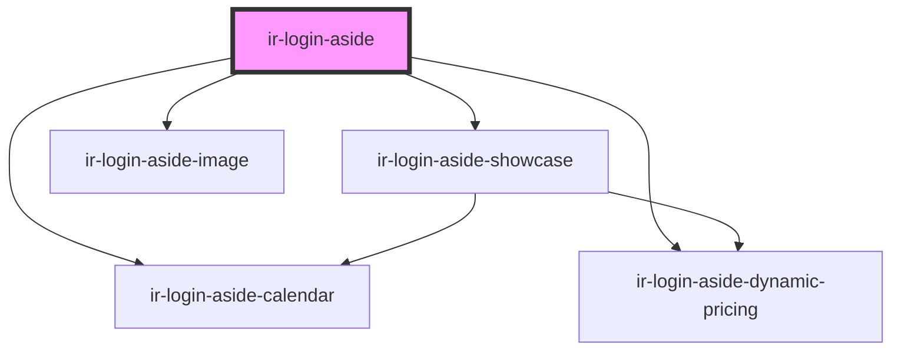

# ir-login-aside

<!-- Auto Generated Below -->

## Properties

| Property        | Attribute   | Description                                                                         | Type                                                       | Default      |
| --------------- | ----------- | ----------------------------------------------------------------------------------- | ---------------------------------------------------------- | ------------ |
| `imageAlt`      | `image-alt` | Alternative text for the image. Empty means decorative.                             | `string`                                                   | `''`         |
| `imageSrc`      | `image-src` | Image URL, used when `view` is `image`.                                             | `string`                                                   | `undefined`  |
| `localeEntries` | --          | Server-provided `Lcz_*` translations, passed through to every view that shows copy. | `{ [x: string]: string; }`                                 | `null`       |
| `view`          | `view`      | Which aside content to render.                                                      | `"calendar" \| "dynamic-pricing" \| "image" \| "showcase"` | `'calendar'` |

## Dependencies

### Depends on

- [ir-login-aside-calendar](ir-login-aside-calendar)
- [ir-login-aside-dynamic-pricing](ir-login-aside-dynamic-pricing)
- [ir-login-aside-showcase](ir-login-aside-showcase)
- [ir-login-aside-image](ir-login-aside-image)

### Graph

----------------------------------------------

*Built with [StencilJS](https://stenciljs.com/)*
