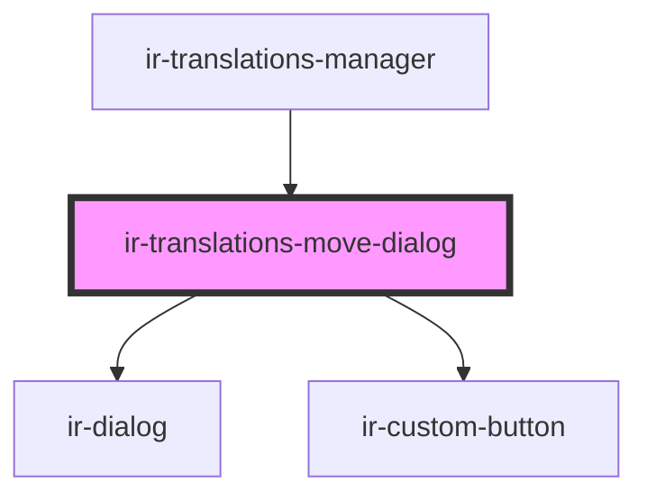

# ir-translations-move-dialog

<!-- Auto Generated Below -->

## Overview

Moves one setup entry to another table through Move_Setup_Entry — the
backend re-homes the row, so nothing is re-created or soft-deleted here.

The destination list is whatever the parent passes as `tables`: the manager
hands over the same set its header picker offers, so the "only used tables"
setting narrows both the same way. The search box is a local filter over
that list, and the source table is never offered as a destination.

## Properties

| Property     | Attribute     | Description                                                                                       | Type                 | Default     |
| ------------ | ------------- | ------------------------------------------------------------------------------------------------- | -------------------- | ----------- |
| `entry`      | --            | The row being moved. Its `tableName` is the source table.                                         | `TranslationEntry`   | `null`      |
| `open`       | `open`        |                                                                                                   | `boolean`            | `false`     |
| `sourceCode` | `source-code` | Language whose value is shown next to the key, so the user can tell rows with similar keys apart. | `string`             | `undefined` |
| `tables`     | --            | Candidate destinations — the tables the header picker shows.                                      | `TranslationTable[]` | `[]`        |

## Events

| Event         | Description                                                                                        | Type                                 |
| ------------- | -------------------------------------------------------------------------------------------------- | ------------------------------------ |
| `closeDialog` |                                                                                                    | `CustomEvent<void>`                  |
| `entryMoved`  | Emitted once the API confirmed the move. The parent owns closing the dialog and updating its rows. | `CustomEvent<TranslationEntryMoved>` |

## Dependencies

### Used by

 - [ir-translations-manager](..)

### Depends on

- [ir-dialog](../../ui/ir-dialog)
- [ir-custom-button](../../ui/ir-custom-button)

### Graph

----------------------------------------------

*Built with [StencilJS](https://stenciljs.com/)*
