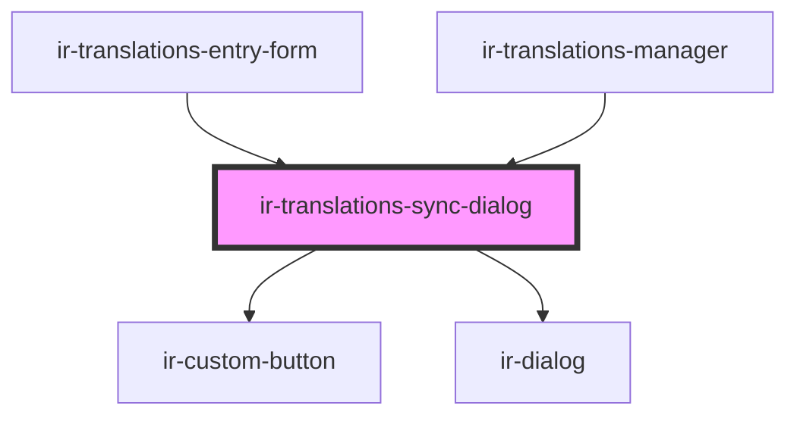

# ir-translations-sync-dialog

<!-- Auto Generated Below -->

## Overview

Asks whether a language edit should cross into or out of the sync-guarded tables
(see `SYNC_GUARDED_TABLES`). Both edit paths await `ask()` mid-save, so the answer
comes back as a promise rather than an event.

## Methods

### `ask(prompt: AskablePrompt) => Promise<SyncAnswer | null>`

Resolves with the user's answer, or `null` if they dismissed the dialog — the caller should then abort the save.

#### Parameters

| Name     | Type                                                            | Description |
| -------- | --------------------------------------------------------------- | ----------- |
| `prompt` | `{ kind: "confirm"; } \| { kind: "choose"; tables: string[]; }` |             |

#### Returns

Type: `Promise<SyncAnswer>`

## Dependencies

### Used by

 - [ir-translations-entry-form](../ir-translations-entry-drawer/ir-translations-entry-form)
 - [ir-translations-manager](..)

### Depends on

- [ir-custom-button](../../ui/ir-custom-button)
- [ir-dialog](../../ui/ir-dialog)

### Graph

----------------------------------------------

*Built with [StencilJS](https://stenciljs.com/)*
