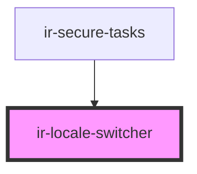

# ir-locale-switcher

<!-- Auto Generated Below -->

## Overview

A floating dev/QA panel for switching language, calendar system,
numbering system and text direction at runtime.

All user-selected settings are persisted in localStorage and restored
automatically the next time the page is opened.

## Properties

| Property     | Attribute     | Description                                                    | Type                                                         | Default        |
| ------------ | ------------- | -------------------------------------------------------------- | ------------------------------------------------------------ | -------------- |
| `collapsed`  | `collapsed`   | Start collapsed to a single button when no saved state exists. | `boolean`                                                    | `true`         |
| `placement`  | `placement`   | Corner to pin the panel to.                                    | `"bottom-end" \| "bottom-start" \| "top-end" \| "top-start"` | `'bottom-end'` |
| `sampleDate` | `sample-date` | Sample date for the preview, YYYY-MM-DD. Defaults to today.    | `string`                                                     | `undefined`    |

## Dependencies

### Used by

 - [ir-secure-tasks](../../ir-secure-tasks)

### Graph

----------------------------------------------

*Built with [StencilJS](https://stenciljs.com/)*
