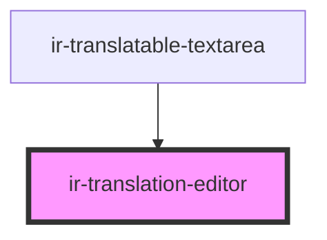

# ir-translation-editor

<!-- Auto Generated Below -->

## Overview

Side-by-side translation editor: a language selector, the default-language text as a read-only reference,
and a textarea for the selected language. Stateless about edits — it shows `value` and reports keystrokes
through `translationInput`; the owner decides when to save.

## Properties

| Property          | Attribute          | Description                                                                                   | Type                                                                  | Default      |
| ----------------- | ------------------ | --------------------------------------------------------------------------------------------- | --------------------------------------------------------------------- | ------------ |
| `appearance`      | `appearance`       |                                                                                               | `"filled" \| "filled-outlined" \| "outlined"`                         | `'outlined'` |
| `defaultLanguage` | `default-language` |                                                                                               | `string`                                                              | `'en'`       |
| `displayLocale`   | `display-locale`   | Locale used to display language names.                                                        | `string`                                                              | `undefined`  |
| `label`           | `label`            | Field label, used in the textarea's accessible name.                                          | `string`                                                              | `undefined`  |
| `labels`          | --                 |                                                                                               | `TranslatableTextareaLabels`                                          | `{}`         |
| `language`        | `language`         | The language being edited. Updated when the user picks another one.                           | `string`                                                              | `undefined`  |
| `languages`       | --                 | All languages; the default language is shown as the reference and excluded from the selector. | `TranslatableLanguage[]`                                              | `[]`         |
| `maxlength`       | `maxlength`        |                                                                                               | `number`                                                              | `undefined`  |
| `readonly`        | `readonly`         |                                                                                               | `boolean`                                                             | `false`      |
| `rows`            | `rows`             |                                                                                               | `number`                                                              | `6`          |
| `size`            | `size`             |                                                                                               | `"l" \| "large" \| "m" \| "medium" \| "s" \| "small" \| "xl" \| "xs"` | `'s'`        |
| `value`           | --                 | Text per language to display (saved text merged with any unsaved edits).                      | `{ [x: string]: string; }`                                            | `{}`         |
| `withCount`       | `with-count`       |                                                                                               | `boolean`                                                             | `false`      |

## Events

| Event                       | Description                                             | Type                                  |
| --------------------------- | ------------------------------------------------------- | ------------------------------------- |
| `translationInput`          | Emitted on every keystroke in the translation textarea. | `CustomEvent<TranslationInputDetail>` |
| `translationLanguageChange` | Emitted when the user selects another language.         | `CustomEvent<string>`                 |

## Methods

### `focusInput() => Promise<void>`

Focuses the translation textarea.

#### Returns

Type: `Promise<void>`

## Dependencies

### Used by

 - [ir-translatable-textarea](..)

### Graph

----------------------------------------------

*Built with [StencilJS](https://stenciljs.com/)*
