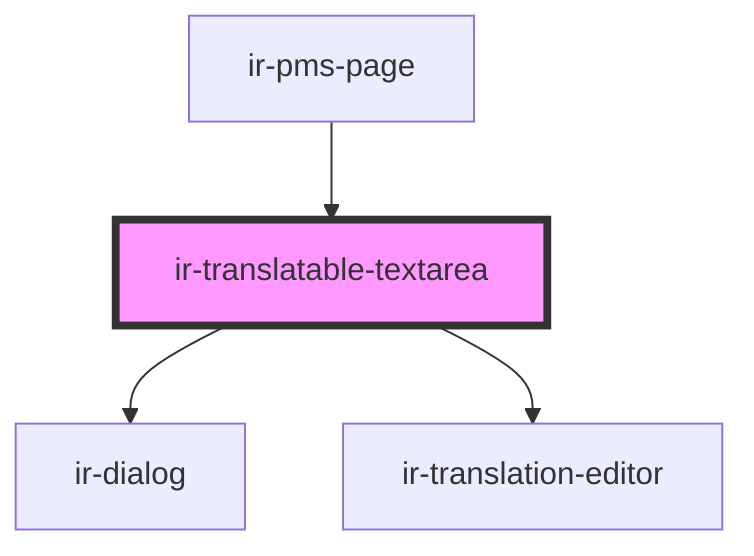

# ir-translatable-textarea

<!-- Auto Generated Below -->

## Overview

A multilingual textarea modelled on Shopify's translation flow: the field itself is edited in the default
language (English unless overridden), which is required. Translations are made in a separate side-by-side
editor (`ir-translation-editor`, inside a dialog) and are only committed when the user saves.

Value is a map keyed by BCP-47 code. Form-associated: submits `JSON.stringify(value)` under `name`, and
blocks submission while the default language is blank.

## Properties

| Property          | Attribute          | Description                                                                                                | Type                                                                  | Default      |
| ----------------- | ------------------ | ---------------------------------------------------------------------------------------------------------- | --------------------------------------------------------------------- | ------------ |
| `appearance`      | `appearance`       |                                                                                                            | `"filled" \| "filled-outlined" \| "outlined"`                         | `'outlined'` |
| `defaultLanguage` | `default-language` | The source language: edited inline and required.                                                           | `string`                                                              | `'en'`       |
| `disabled`        | `disabled`         |                                                                                                            | `boolean`                                                             | `false`      |
| `displayLocale`   | `display-locale`   | Locale used to display language names. Defaults to the nearest `lang` attribute, then the browser locale.  | `string`                                                              | `undefined`  |
| `hint`            | `hint`             | Help text under the inline textarea.                                                                       | `string`                                                              | `undefined`  |
| `label`           | `label`            | Field label. Also used in the translation editor's title.                                                  | `string`                                                              | `undefined`  |
| `labels`          | --                 | Overrides for the built-in English UI strings.                                                             | `TranslatableTextareaLabels`                                          | `{}`         |
| `languages`       | --                 | Languages the field can be translated into. The default language may be listed; it is skipped as a target. | `TranslatableLanguage[]`                                              | `[]`         |
| `maxlength`       | `maxlength`        | Maximum characters per language.                                                                           | `number`                                                              | `undefined`  |
| `name`            | `name`             | Form field name. The submitted value is the JSON-encoded translation map.                                  | `string`                                                              | `undefined`  |
| `placeholder`     | `placeholder`      | Placeholder for the inline textarea.                                                                       | `string`                                                              | `undefined`  |
| `readonly`        | `readonly`         |                                                                                                            | `boolean`                                                             | `false`      |
| `resize`          | `resize`           |                                                                                                            | `"auto" \| "both" \| "horizontal" \| "none" \| "vertical"`            | `'auto'`     |
| `rows`            | `rows`             |                                                                                                            | `number`                                                              | `4`          |
| `size`            | `size`             |                                                                                                            | `"l" \| "large" \| "m" \| "medium" \| "s" \| "small" \| "xl" \| "xs"` | `'s'`        |
| `value`           | --                 | Text per language, e.g. `{ en: '…', fr: '…' }`. Blank translations are never stored.                       | `{ [x: string]: string; }`                                            | `{}`         |
| `withCount`       | `with-count`       | Shows a character count (remaining characters when `maxlength` is set).                                    | `boolean`                                                             | `false`      |

## Events

| Event         | Description                                                                                 | Type                                         |
| ------------- | ------------------------------------------------------------------------------------------- | -------------------------------------------- |
| `valueChange` | Emitted when the default-language text is edited, and when the translation editor is saved. | `CustomEvent<TranslatableValueChangeDetail>` |

## Methods

### `checkValidity() => Promise<boolean>`

#### Returns

Type: `Promise<boolean>`

### `openTranslations(code?: string) => Promise<void>`

Opens the translation editor, optionally on a specific language.

#### Parameters

| Name   | Type     | Description |
| ------ | -------- | ----------- |
| `code` | `string` |             |

#### Returns

Type: `Promise<void>`

### `reportValidity() => Promise<boolean>`

Like `checkValidity()`, but also shows the error and focuses the field.

#### Returns

Type: `Promise<boolean>`

## Shadow Parts

| Part      | Description |
| --------- | ----------- |
| `"label"` |             |

## Dependencies

### Used by

 - [ir-pms-page](../../pms-header/ir-pms-page)

### Depends on

- [ir-dialog](../ir-dialog)
- [ir-translation-editor](ir-translation-editor)

### Graph

----------------------------------------------

*Built with [StencilJS](https://stenciljs.com/)*
